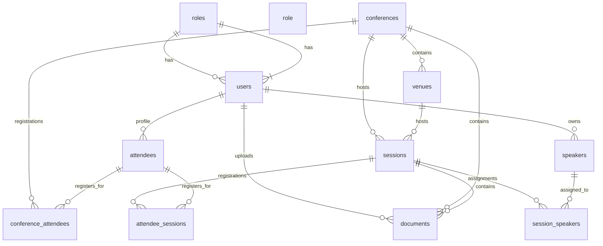

# Convene — Conference Management System

A private, full-stack conference management application for administrators, organisers, speakers, and attendees.

Convene is a management dashboard, **not** a public conference advertising website, marketing portal, or public information page. Users must authenticate before accessing any part of the system. Each user sees a role-specific dashboard with backend-enforced permissions.

## Table of Contents

1. [Project Overview](#1-project-overview)
2. [Project Objectives](#2-project-objectives)
3. [System Scope](#3-system-scope)
4. [Features and Functionalities](#4-features-and-functionalities)
5. [User Roles and Permissions](#5-user-roles-and-permissions)
6. [Authentication and Registration Flow](#6-authentication-and-registration-flow)
7. [Business Rules and System Logic](#7-business-rules-and-system-logic)
8. [Technology Stack](#8-technology-stack)
9. [System Architecture](#9-system-architecture)
10. [Application Data Flow](#10-application-data-flow)
11. [Project Structure](#11-project-structure)
12. [Detailed Frontend File Guide](#12-detailed-frontend-file-guide)
13. [Detailed Backend File Guide](#13-detailed-backend-file-guide)
14. [Database Design](#14-database-design)
15. [Entity Relationships](#15-entity-relationships)
16. [API Documentation](#16-api-documentation)
17. [Role-Based Navigation and Dashboards](#17-role-based-navigation-and-dashboards)
18. [Development Environment Setup](#18-development-environment-setup)
19. [Environment Variables](#19-environment-variables)
20. [Database Setup, Migrations and Seeding](#20-database-setup-migrations-and-seeding)
21. [Running the Application](#21-running-the-application)
22. [Testing and Verification](#22-testing-and-verification)
23. [Git and GitHub Workflow](#23-git-and-github-workflow)
24. [Team Structure](#24-team-structure)
25. [Individual Member Responsibilities](#25-individual-member-responsibilities)
26. [File Ownership and Collaboration](#26-file-ownership-and-collaboration)
27. [Development Work Plan](#27-development-work-plan)
28. [Coding Standards](#28-coding-standards)
29. [Security Guidelines](#29-security-guidelines)
30. [Deployment](#30-deployment)
31. [Troubleshooting](#31-troubleshooting)
32. [Frequently Asked Questions](#32-frequently-asked-questions)
33. [Project Limitations and Future Improvements](#33-project-limitations-and-future-improvements)
34. [License](#34-license)
35. [Project Maintenance Information](#35-project-maintenance-information)

---

## 1. Project Overview

Convene is a conference management system designed for universities and conference organisers to manage conferences from planning through execution.

### Core application principle

Authentication is the entry point. There is no public homepage, landing page, or marketing content. Opening the application displays the login page. Any attempt to access a protected route without a valid session redirects to login.

The system supports four roles:

| Role | Created by | Primary purpose |
|------|-----------|-----------------|
| Admin | Developer seeding | System administration and overall oversight |
| Organiser | Developer seeding | Conference planning and management |
| Speaker | Public signup or admin/organiser creation | Manage speaker profile and assigned sessions |
| Attendee | Public signup or admin/organiser creation | Register for conferences and sessions |

Admin and organiser accounts are created through developer-controlled database seeding only. Public signup is restricted to **attendee** and **speaker** roles.

### Implementation status labels used in this README

Throughout this document, features are marked with one of the following labels:

- **Implemented:** Verified in the existing source code.
- **Partially implemented:** Some functionality exists but is incomplete or not enforced end-to-end.
- **Planned:** Required by project scope but not yet implemented.
- **Needs verification:** Cannot be confirmed from the current repository.

---

## 2. Project Objectives

1. Provide a private, authentication-first dashboard for conference management.
2. Enforce role-based access control on the backend (not merely by hiding frontend UI).
3. Support self-service registration for attendees and speakers.
4. Allow admins and organisers to manage members, conferences, venues, sessions, and speakers.
5. Enforce conference and session capacity limits.
6. Prevent duplicate registrations and scheduling conflicts.
7. Track attendance and session check-ins.
8. Generate registration and attendance reports.
9. Manage conference documents and files.

---

## 3. System Scope

### 3.1 In scope

- Authentication (signup, login, logout, session via cookie).
- Role-based access control (admin, organiser, speaker, attendee).
- Member management (create, list, update, deactivate/activate, remove).
- Conference management (CRUD, lifecycle status, capacity).
- Venue management (CRUD, building/room/capacity).
- Session management (CRUD, scheduling, capacity, venue assignment).
- Speaker management (profiles, session assignment roles).
- Attendee conference registration and session registration.
- Capacity enforcement on conferences and sessions.
- Duplicate registration prevention.
- Attendee scheduling conflict prevention.
- Session check-in and attendance tracking.
- Document listing.
- Registration and attendance reports.
- Role-based dashboards and sidebar navigation.

### 3.2 Out of scope

- Payments, tickets, revenue, financial reports, invoices, subscriptions.
- Waitlists for full conferences or sessions.
- Email notifications.
- QR-based check-in.
- Calendar exports.
- Advanced analytics beyond the existing reports.

### 3.3 What the system does NOT handle

Convene does **not** handle financial transactions.

- There is no payment system.
- There is no revenue management.
- There is no ticket purchasing.
- There are no invoices or refunds.
- There is no payment gateway integration.

Conference and session registration is for participation management only, not payment.

---

## 4. Features and Functionalities

### 4.1 Authentication and account management (Implemented)

- **Login:** POST `/api/auth/login` — email + password, returns session cookie.
- **Signup:** POST `/api/auth/signup` — public, restricted to attendee/speaker roles.
- **Logout:** POST `/api/auth/logout` — clears session cookie.
- **Session:** `session_id` httpOnly cookie, 7-day max age, `SameSite=Lax`, secure in production.
- **Current user:** GET `/api/auth/me` — returns authenticated user profile.
- **Password security:** bcryptjs hashing with 10 salt rounds.
- **Protected routes:** All API routes except auth and health require a valid session.
- **Inactive accounts:** Users with `status = "inactive"` cannot log in; active sessions are rejected with 403.
- **Role-based redirects:** Frontend redirects users to their role-specific dashboard after login.

### 4.2 Member management (Implemented)

Admin and organiser accounts can manage members through:

- GET `/api/auth/members` — list members (excludes admin accounts), with optional `search`, `role`, `status` filters.
- GET `/api/auth/members/stats` — member statistics (total attendees, total speakers, active, inactive).
- POST `/api/auth/members` — create attendee or speaker account.
- PATCH `/api/auth/members/:id` — update member name, email, or role.
- PATCH `/api/auth/members/:id/status` — set member status to `active` or `inactive`.
- DELETE `/api/auth/members/:id` — remove a member.

**Rules:**
- Admin and organiser accounts cannot be created, modified, or removed through member management.
- Public signup is restricted to attendee and speaker roles.
- Deactivation is preferred over deletion when historical registration and attendance information must be preserved.

### 4.3 Conference management (Implemented)

- GET `/api/conferences` — list all conferences.
- POST `/api/conferences` — create conference (organiser, admin).
- GET `/api/conferences/:id` — get conference detail with speakers, venues, sessions, documents.
- PATCH `/api/conferences/:id` — update conference (organiser, admin).
- DELETE `/api/conferences/:id` — delete conference (organiser, admin).
- GET `/api/conferences/available` — list conferences with capacity and availability (all authenticated).
- POST `/api/conferences/:id/register` — register for a conference (all authenticated).
- DELETE `/api/conferences/:id/cancel` — cancel conference registration (all authenticated).
- GET `/api/conferences/:id/registrations` — list conference registrations (organiser, admin).

**Conference fields:** id, title, description, startDate, endDate, createdBy, createdAt, capacity (nullable), status.

**Conference statuses (Implemented — auto-computed):**

| Status | Meaning |
|--------|---------|
| Draft | Conference is being prepared |
| Upcoming | Conference has not started |
| Ongoing | Conference is currently taking place |
| Completed | Conference end time has passed |
| Cancelled | Conference has been cancelled |

Status is calculated automatically from `startDate`/`endDate` unless the status is explicitly `draft` or `cancelled`. Past conferences display Completed automatically.

### 4.4 Venue management (Implemented)

- GET `/api/venues` — list all venues.
- POST `/api/venues` — create venue (organiser, admin).
- PATCH `/api/venues/:id` — update venue (organiser, admin).
- DELETE `/api/venues/:id` — delete venue (organiser, admin).

**Venue fields:** id, conferenceId, name, building, room, capacity, createdAt.

**Scheduling conflict prevention:** Helper functions `isVenueAvailable()` and `isSpeakerAvailable()` exist in the source code (**Implemented as helpers**), but they are **not currently enforced** in the POST/PATCH venue or session route handlers (**Partially implemented** — conflict logic exists but is not called during create/update).

### 4.5 Session management (Implemented)

- GET `/api/sessions` — list sessions, optional `conferenceId` filter.
- POST `/api/sessions` — create session (organiser, admin).
- GET `/api/sessions/:id` — get session detail (via conference detail endpoint).
- PATCH `/api/sessions/:id` — update session (organiser, admin).
- DELETE `/api/sessions/:id` — delete session (organiser, admin).
- GET `/api/sessions/available` — list sessions with capacity and availability (all authenticated).
- POST `/api/sessions/:id/register` — register for a session (all authenticated).
- DELETE `/api/sessions/:id/cancel` — cancel session registration (all authenticated).
- GET `/api/sessions/:id/registrations` — list session registrations (organiser, admin).

**Session fields:** id, conferenceId, venueId (nullable), title, description, startTime, endTime, createdAt, capacity (nullable).

**Session statuses (Implemented — auto-computed):**

| Status | Meaning |
|--------|---------|
| Scheduled / Upcoming | Session has not started |
| Ongoing | Session is currently taking place |
| Completed | Session end time has passed |
| Cancelled | Session has been cancelled |

### 4.6 Speaker management (Implemented)

- GET `/api/speakers` — list speakers, optional `search` and `conferenceId` filters.
- POST `/api/speakers` — create speaker profile (organiser, admin).
- PATCH `/api/speakers/:id` — update speaker bio/photo (organiser, admin).
- DELETE `/api/speakers/:id` — delete speaker (organiser, admin).
- POST `/api/session-speakers` — assign speaker to session (organiser, admin).
- DELETE `/api/session-speakers/:id` — remove speaker from session (organiser, admin).

**Speaker fields:** id, userId (nullable), bio, photoUrl (nullable), createdAt.

**Speaker assignment roles (Implemented):** keynote, speaker, panelist, moderator.

**System role vs session assignment role:** A user's account role (e.g. `speaker`) is separate from their assignment within a session (e.g. `moderator`). A user with account role `speaker` can be assigned as `moderator` for a particular session, and vice versa.

### 4.7 Attendee management and registration (Implemented)

- Attendee self-registration via public signup (role: attendee).
- Admin/organiser-created attendee accounts via member management.
- GET `/api/attendees` — list conference attendees (organiser, admin).
- POST `/api/attendees` — register an attendee for a conference (organiser, admin).
- Conference registration: POST `/api/conferences/:id/register` — self-service registration.
- Session registration: POST `/api/sessions/:id/register` — self-service registration.
- Registration cancellation: DELETE endpoints for both conference and session registration.

**Conference registration and session registration are separate processes.** An attendee registers for a conference, then registers for individual sessions within that conference.

**Registration statuses:** conference registrations use `confirmed`/`cancelled`; session registrations use `registered`/`attended`/`cancelled`/`no_show`.

### 4.8 Capacity management (Implemented)

**Conference capacity:**
- Maximum number of permitted conference registrations (`capacity` field, nullable).
- Number of active (non-cancelled) registrations.
- Remaining seats = capacity − registered count.
- Full conferences reject additional registrations (HTTP 400).

**Session capacity:**
- Maximum permitted session registrations (`capacity` field, nullable).
- Registered attendees count.
- Remaining seats = capacity − registered count.
- Full sessions reject additional registrations (HTTP 400).

**Rules enforced on the backend:**
- Duplicate registrations are prevented (same attendee/conference or attendee/session).
- Cancelled registrations release reserved capacity.
- Capacity is checked at registration time.

**No waitlist feature is implemented.** Do not document waitlists as existing functionality.

### 4.9 Attendance and check-in (Implemented)

- POST `/api/attendee-sessions/register` — register for a session (all authenticated).
- POST `/api/attendee-sessions/:id/check-in` — check in an attendee (organiser, admin).
- GET `/api/sessions/:id/registrations` — list session registrations with attendance status (organiser, admin).

**Attendance statuses:** `registered`, `attended`, `cancelled`, `no_show`.

An attendee is checked in once; the `checked_in_at` timestamp is recorded and status set to `attended`. No-show status should only be assigned after a session has ended without attendance (currently the system supports the status value; automated no-show assignment is **Needs verification**).

### 4.10 Documents and storage (Partially implemented)

- GET `/api/documents` — list documents, optional `type` and `conferenceId` filters (all authenticated).

**Document fields:** id, userId, conferenceId (nullable), sessionId (nullable), type, fileKey, fileUrl (nullable), fileName, fileSize, contentType, createdAt.

**Document types:** paper, id-card, certificate, image, and others.

**File storage:** `Backend/src/storage/r2.ts` defines a Cloudflare R2 storage seam with `uploadFile`, `deleteFile`, and `getFileURL` helpers (**Implemented as a type-level seam**). However, **no document upload route exists** in the running backend, and the R2 helpers are not wired into any controller (**Partially implemented** — storage interface defined, not integrated).

**Maximum file size:** The frontend upload UI references 25 MB. This is **Needs verification** against a backend limit, since no upload endpoint exists.

---

## 5. User Roles and Permissions

This is the **intended** permission model, verified against the backend route authorization middleware.

| Feature | Admin | Organiser | Speaker | Attendee |
|---------|-------|-----------|---------|----------|
| Access dashboard | Yes | Yes | Yes | Yes |
| Manage conferences (CRUD) | Yes | Yes | No | No |
| Browse conferences | Yes | Yes | Yes | Yes |
| Register for conferences | Yes | Yes | Yes | Yes |
| Manage attendees (CRUD) | Yes | Yes | No | No |
| Manage speakers (CRUD) | Yes | Yes | No | No |
| Add attendees/speakers | Yes | Yes | No | No |
| Manage venues | Yes | Yes | No | No |
| Manage sessions | Yes | Yes | No | No |
| Assign speakers to sessions | Yes | Yes | No | No |
| View assigned sessions | Yes | Yes | Yes | No |
| Register for sessions | Yes | Yes | Yes | Yes |
| Manage check-in | Yes | Yes | No | No |
| View reports | Yes | Yes | No | No |
| Manage system roles | Yes | No | No | No |
| Manage own profile | Yes | Yes | Yes | Yes |
| View settings | Yes | No | No | No |

**Important:** Frontend route visibility (sidebar filtering) does not replace backend authorization. Every protected route checks the session and role on the server. A user who manipulates the frontend to access a restricted URL will still receive HTTP 403 from the backend.

---

## 6. Authentication and Registration Flow

### 6.1 Public user flow

```text
APPLICATION
    |
    v
LOGIN PAGE
    |
New user? / Existing?
   /          \
  v            v
SIGNUP         LOGIN
    |
Select account role
   /          \
  v            v
ATTENDEE      SPEAKER
    |             |
    v             v
CREATE        CREATE
ACCOUNT     ACCOUNT
    |             |
    +-----|-------+
          |
          v
      LOGIN
          |
          v
BACKEND AUTHENTICATION
          |
          v
CHECK USER ROLE + STATUS
          |
+---------+---------+---------+
|         |         |         |
v         v         v         v
ADMIN   ORGANISER SPEAKER   ATTENDEE
DASHBOARD DASHBOARD DASHBOARD DASHBOARD
```

### 6.2 Seeded accounts

Two accounts are provisioned by the seed script (`Backend/scripts/seed.sql`):

| Email | Password | Role | Name |
|-------|----------|------|------|
| samuel@convene.com | Convene@2026 | Admin | Samuel Makokha |
| austin@convene.com | Convene@2026 | Organiser | Austin Omondi |

These accounts cannot be created through public signup — signup only allows `attendee` and `speaker`. The passwords are stored as PBKDF2-SHA256 hashes, never in plain text.

Apply or refresh the seed with:

```bash
cd Backend
wrangler d1 execute convene_db --remote --file=./scripts/seed.sql
```

The seed is idempotent: existing rows are updated in place and missing rows are inserted, so it is safe to re-run.

Any additional attendee, speaker, admin or organiser account is created either through public signup (attendee/speaker only) or by an admin or organiser through the member-management endpoints.

### 6.3 Account management flow

```text
ADMIN / ORGANISER
        |
        v
  MEMBER MANAGEMENT
        |
    +---+---+
    |       |
    v       v
ATTENDEE  SPEAKER
    |       |
    v       v
CREATE   CREATE
UPDATE   UPDATE
DEACTIVATE DEACTIVATE
VIEW     ASSIGN SESSIONS
```

---

## 7. Business Rules and System Logic

### 7.1 Conference lifecycle (Implemented)

Conference status is computed automatically from `startDate` and `endDate`:

| Condition | Result |
|-----------|--------|
| `status` = `cancelled` | Cancelled |
| `status` = `draft` | Draft |
| Now < startDate | Upcoming |
| startDate ≤ now ≤ endDate | Ongoing |
| now > endDate | Completed |

Registration is open only when conference status is `upcoming` or `ongoing`.

### 7.2 Session lifecycle (Implemented)

Session status is computed automatically from `startTime` and `endTime`:

| Condition | Result |
|-----------|--------|
| Now < startTime | Upcoming |
| startTime ≤ now ≤ endTime | Ongoing |
| now > endTime | Completed |

Session registration is open only when the session is `upcoming` AND its conference is `upcoming` or `ongoing`.

### 7.3 Capacity rules (Implemented)

- A conference at full capacity rejects new registrations (HTTP 400).
- A session at full capacity rejects new registrations (HTTP 400).
- Duplicate registrations (same attendee + conference/session, non-cancelled) are rejected (HTTP 400).
- Cancelling a registration releases the reserved seat.

### 7.4 Scheduling conflict rules (Partially implemented)

**Attendee session conflict prevention is implemented** — `isAttendeeAvailableForSession()` prevents an attendee from registering for sessions with overlapping times.

**Venue and speaker conflict detection helpers exist** (`isVenueAvailable()`, `isSpeakerAvailable()`) but are **not invoked** in the POST/PATCH route handlers for venues or sessions. An organiser can currently create a session in a venue that is double-booked, or assign a speaker to overlapping sessions, without backend rejection.

### 7.5 Registration separation (Implemented)

Conference registration and session registration are separate database records:
- `conference_attendees` (or `conferenceRegistrations` in memory) links an attendee to a conference.
- `attendee_sessions` links an attendee to a session.

An attendee registers for a conference before registering for its sessions.

---

## 8. Technology Stack

The following technologies are verified as installed in `package.json` files:

| Layer | Technology | Version | Verified |
|-------|-----------|---------|----------|
| Frontend framework | React | 19.1.0 | Yes |
| Language | TypeScript | ~5.9.3 | Yes |
| Build tool | Vite | 7.3.2 | Yes |
| Styling | Tailwind CSS | 4.1.14 | Yes |
| UI primitives | Radix UI | multiple | Yes |
| Routing | Wouter | 3.3.5 | Yes |
| Server state | TanStack React Query | 5.90.21 | Yes |
| Forms | React Hook Form | 7.55.0 | Yes |
| Validation | Zod | 3.25.76 | Yes |
| Icons | lucide-react | 0.545.0 | Yes |
| Notifications | sonner | 2.0.7 | Yes |
| Date handling | date-fns | 3.6.0 | Yes |
| Charts | recharts | 2.15.2 | Yes |
| Backend runtime | Node.js / Express | Express 5.2.1 | Yes |
| Password hashing | bcryptjs | 3.0.3 | Yes |
| Logging | Pino | 9.14.0 | Yes |
| CORS / cookies | cors, cookie-parser | 2.8.6 / 1.4.7 | Yes |
| ORM (installed) | Drizzle ORM | 0.45.2 | Installed, not used at runtime |
| Bundler | esbuild | 0.25.0 | Yes |
| API client (shared) | @workspace/api-client-react | local | Yes |
| API schemas (shared) | @workspace/api-zod | local | Yes |

**The backend is deployed on Cloudflare Workers with Cloudflare D1.** The Express app is wrapped by a custom Web Request/Response adapter (`Backend/src/worker-adapter.ts`) that bridges Express req/res to Cloudflare Worker `fetch` handlers. Data is persisted in D1 (`convene_db`) with all 16 migrations applied. R2 storage (`Backend/src/storage/r2.ts`) is defined as a type-level seam but not yet wired into routes.

---

## 9. System Architecture

```text
              USER
               |
               v
        FRONTEND (REACT + VITE)
               |
               v
     ROUTING (WOUTER) + PAGES
               |
               v
     AUTH CONTEXT + API SERVICES
               |
          HTTP (credentials: include)
               |
               v
     BACKEND (EXPRESS + NODE.JS)
               |
               v
  AUTHENTICATION (session_id cookie)
               |
               v
  AUTHORIZATION (role-based middleware)
               |
               v
         BUSINESS LOGIC + VALIDATION
               |
               v
     IN-MEMORY DATA STORES (arrays)
               |
               v
        JSON API RESPONSE
               |
               v
      FRONTEND UI UPDATE
```

The backend and frontend communicate over HTTP. The frontend sends `credentials: 'include'` on all API requests so the `session_id` cookie is passed cross-origin. The backend is deployed on Cloudflare Workers (`convene_backend`) and serves all API routes under `/api`.

**Shared packages:**
- `@workspace/api-zod` — Zod validation schemas and TypeScript types used by the backend.
- `@workspace/api-client-react` — Generated React Query hooks and fetch helpers used by the frontend.

**Runtime:** Cloudflare Workers (Express wrapped via `Backend/src/worker-adapter.ts`), Cloudflare D1 (`convene_db`), Cloudflare Pages (frontend), Cloudflare R2 (storage seam defined, not yet wired).

---

## 10. Application Data Flow

Example: Attendee registering for a conference.

1. Attendee opens the Available Conferences page (`/attendee/conferences`).
2. Frontend calls `GET /api/conferences/available` (with session cookie).
3. Backend authenticates the session cookie against D1.
4. Backend computes conference status and remaining capacity from D1.
5. Frontend displays conferences with available spots.
6. Attendee clicks Register.
7. Frontend calls `POST /api/conferences/:id/register`.
8. Backend validates: session valid, conference exists, registration open, no duplicate, capacity not exceeded.
9. Backend creates the conference registration record in D1.
10. Backend returns HTTP 201 with the registration.
11. Frontend updates the UI to show "Registered" / "Cancel registration".

Example: Organiser creating a session.

1. Organiser opens Schedule (`/schedule`) and clicks Add session.
2. Frontend calls `POST /api/sessions` with session details.
3. Backend authenticates and authorises (organiser/admin).
4. Backend validates input with Zod schema.
5. Backend creates the session record in memory.
6. Backend returns HTTP 201 with the session.

---

## 11. Project Structure

```
conference-management-system/
├── .gitignore
├── .kilo/
├── package.json                 # Root workspace (concurrently, build, install:all)
├── README.md
│
├── Backend/                     # Express + TypeScript backend (Cloudflare Workers)
│   ├── package.json             # express, cors, cookie-parser, bcryptjs, pino, zod, drizzle-orm, esbuild, typescript
│   ├── tsconfig.json
│   ├── build.mjs                # esbuild bundle to dist/
│   ├── wrangler.toml            # Cloudflare Workers config (D1 binding, NODE_ENV)
│   ├── .tsbuildinfo
│   ├── dist/                    # Built output
│   ├── node_modules/
│   ├── package-lock.json
│   ├── migrations/              # SQL migration files (001-016) — applied to D1 on deployment
│   ├── seed-data.sql            # Seed data for conferences, venues, sessions, speakers
│   ├── scripts/
│   │   └── seed.ts              # Seed script (admin/organiser + demo users)
│   └── src/
│       ├── app.ts               # Express app setup, CORS, cookie-parser, route mounting, error middleware
│       ├── index.ts             # Local dev entry point (PORT env var)
│       ├── index.worker.ts      # Cloudflare Workers entry point
│       ├── worker-adapter.ts    # Express→Web Request/Response adapter + auth lookup
│       ├── types.ts             # Cloudflare Env interface (D1 + R2 bindings)
│       ├── routes/
│       │   ├── index.ts         # Route aggregator (auth + conference)
│       │   ├── health.ts        # Health check endpoint
│       │   ├── auth.ts          # Auth + member management routes
│       │   └── conference.ts    # Conference/session/registration routes
│       ├── controllers/
│       │   └── auth.ts          # Auth + member management controllers (D1-backed)
│       ├── middleware/
│       │   └── auth.ts          # Auth middleware (sync, auth lookup in worker adapter)
│       ├── lib/
│       │   ├── logger.ts        # Pino logger
│       │   └── api-zod/         # Shared Zod schemas
│       └── storage/
│           └── r2.ts            # R2 storage seam (type-level, not wired into routes)
│       ├── index.ts             # Server entry point (listens on PORT)
│       ├── routes/
│       │   ├── index.ts         # Route registration (auth, health, conference)
│       │   ├── auth.ts          # Auth + member management endpoints
│       │   ├── conference.ts    # Conferences, venues, sessions, speakers, attendees, registrations, reports
│       │   └── health.ts        # GET /api/healthz
│       ├── middleware/
│       │   └── auth.ts          # authenticate, authorize, password hashing, session cookies, user store
│       ├── middlewares/         # Empty directory (reserved)
│       ├── controllers/
│       │   └── auth.ts          # Auth and member controllers
│       ├── services/            # Empty directory (reserved)
│       ├── validators/          # Empty directory (reserved)
│       ├── storage/
│       │   └── r2.ts            # Cloudflare R2 storage seam (type-level, not wired into routes)
│       └── lib/
│           ├── logger.ts        # Pino logger
│           └── .gitkeep
│       └── lib/
│           ├── api-zod/         # Shared Zod schemas + OpenAPI spec version 0.2.0
│           ├── api-spec/        # OpenAPI spec config
│           └── db/              # Drizzle config (reserved, not used at runtime)
│
├── Frontend/                    # React 19 + Vite frontend
│   ├── package.json             # react 19, vite 7, tailwind 4, radix, react-query, wouter, zod
│   ├── tsconfig.json
│   ├── vite.config.ts           # Vite config, port 5173, path aliases
│   ├── index.html
│   ├── public/
│   │   ├── favicon.svg
│   │   └── robots.txt
│   ├── dist/                    # Built output
│   ├── node_modules/
│   ├── package-lock.json
│   ├── components.json
│   ├── lib/
│   │   └── api-client-react/    # Shared API client package
│   │       ├── package.json
│   │       ├── tsconfig.json
│   │       ├── src/
│   │       │   ├── index.ts     # Package exports
│   │       │   ├── custom-fetch.ts # Fetch wrapper with credentials: include
│   │       │   ├── generated/api.ts        # Generated API hooks (orval)
│   │       │   ├── generated/api.schemas.ts # Generated TypeScript types
│   │       │   └── registration.ts # Conference/session registration hooks
│   │       └── dist/            # Built declarations
│   └── src/
│       ├── App.tsx              # Application router + page components
│       ├── main.tsx             # React entry point
│       ├── index.css            # Tailwind CSS + design tokens
│       ├── context/
│       │   └── auth-context.tsx # AuthProvider / useAuth (session cookie API calls)
│       ├── components/
│       │   ├── layout/
│       │   │   └── dashboard-layout.tsx # Sidebar + layout, role-filtered nav
│       │   ├── error-boundary.tsx
│       │   └── ui/              # Radix-based shadcn/ui components (button, dialog, etc.)
│       ├── pages/
│       │   ├── auth/
│       │   │   ├── login.tsx
│       │   │   └── signup.tsx
│       │   ├── admin/
│       │   │   └── dashboard.tsx
│       │   ├── organiser/
│       │   │   └── dashboard.tsx
│       │   ├── speaker/
│       │   │   └── dashboard.tsx
│       │   ├── attendee/
│       │   │   ├── dashboard.tsx
│       │   │   ├── conference-browse.tsx
│       │   │   └── session-browse.tsx
│       │   └── not-found.tsx
│       ├── hooks/
│       │   ├── use-mobile.tsx
│       │   └── use-toast.ts
│       ├── services/            # Empty directory (reserved)
│       └── lib/
│           └── utils.ts         # cn() utility
```

**Important structural notes:**
- `Backend/src/lib/` contains both app-level files (`logger.ts`) and shared package directories (`api-zod`, `api-spec`, `db`).
- The `services/`, `validators/`, and `middlewares/` directories exist but are empty — reserved for future organisation.
- `Backend/lib/db/` exists (Drizzle config reference in tsconfig) but is not used by the running Express app.
- `Frontend/src/services/` exists but is empty — API calls are currently made inline in `auth-context.tsx` and via the generated `@workspace/api-client-react` hooks.

---

## 12. Detailed Frontend File Guide

| File | Responsibility | Owner | Shared? |
|------|---------------|-------|---------|
| `Frontend/src/main.tsx` | React application entry point, ErrorBoundary wrapper | Samuel | Yes |
| `Frontend/src/App.tsx` | Wouter router, route definitions, all page components (Conferences, Speakers, Attendees, Venues, Schedule, Documents, Reports, Profile, Settings, auth pages, modals) | Samuel / coordinated | Yes |
| `Frontend/src/index.css` | Tailwind CSS imports, design tokens, theme variables | Shared | Yes |
| `Frontend/src/context/auth-context.tsx` | AuthProvider/useAuth: login, signup, logout, fetchMe, user state; calls `/api/auth/*` with credentials | Samuel | Yes |
| `Frontend/src/components/layout/dashboard-layout.tsx` | Sidebar navigation, role-filtered nav items, logout, mobile drawer | Shared | Yes |
| `Frontend/src/components/error-boundary.tsx` | React error boundary fallback | Samuel | Yes |
| `Frontend/src/components/ui/*` | Radix-based shadcn/ui components (button, dialog, form, etc.) | Shared | Yes |
| `Frontend/src/lib/utils.ts` | `cn()` className utility | Shared | Yes |
| `Frontend/src/hooks/use-mobile.tsx` | Mobile breakpoint detection | Shared | Yes |
| `Frontend/src/hooks/use-toast.ts` | Toast notification hook | Shared | Yes |
| `Frontend/src/pages/auth/login.tsx` | Login page (email/password) | Austin | Yes |
| `Frontend/src/pages/auth/signup.tsx` | Signup page (name, email, password, attendee/speaker role) | Austin | Yes |
| `Frontend/src/pages/not-found.tsx` | 404 fallback | Samuel | Yes |
| `Frontend/src/pages/admin/dashboard.tsx` | Admin dashboard (stats, quick actions) | Samuel | Yes |
| `Frontend/src/pages/organiser/dashboard.tsx` | Organiser dashboard | Austin | Yes |
| `Frontend/src/pages/speaker/dashboard.tsx` | Speaker dashboard | Steve / Fred | Yes |
| `Frontend/src/pages/attendee/dashboard.tsx` | Attendee dashboard | Adachi / Sean | Yes |
| `Frontend/src/pages/attendee/conference-browse.tsx` | Browse conferences, register/cancel | Adachi | Yes |
| `Frontend/src/pages/attendee/session-browse.tsx` | Browse sessions, register/cancel | Adachi | Yes |

**Shared files requiring coordination:** `App.tsx`, `dashboard-layout.tsx`, `auth-context.tsx`, `index.css`, `api-client-react`, `api-zod`.

---

## 13. Detailed Backend File Guide

| File | Responsibility | Owner | Shared? |
|------|---------------|-------|---------|
| `Backend/src/index.ts` | Local development entry point, reads `PORT`, starts the Express listener | Samuel | Yes |
| `Backend/src/index.worker.ts` | Cloudflare Workers entry point (`fetch` handler) | Samuel | Yes |
| `Backend/src/worker-adapter.ts` | Adapts Express req/res to the Worker `fetch` API; also resolves the session user from D1 before Express runs | Samuel | Yes |
| `Backend/src/types.ts` | Cloudflare `Env` interface (D1 `convene_db`, R2 `convene_bucket`) | Samuel | Yes |
| `Backend/src/app.ts` | Express app setup, CORS (credentials), cookie-parser, mounts `/api` router, error middleware | Samuel | Yes |
| `Backend/src/routes/index.ts` | Route registration: auth, health, conference routers | Samuel | Yes |
| `Backend/src/routes/auth.ts` | Auth endpoints (signup/login/logout/me) + member management (CRUD, stats, status) | Austin / Samuel | Yes |
| `Backend/src/routes/conference.ts` | Conferences, venues, sessions, speakers, attendees, registrations, session-speakers, documents, reports — all D1-backed | Austin / Adachi / Jeff / Sean / Steve / Fred | Yes |
| `Backend/src/routes/health.ts` | GET /api/healthz | Samuel | Yes |
| `Backend/src/middleware/auth.ts` | authenticate, authorize, PBKDF2 hash/compare, session cookie, activity logging | Samuel | Yes |
| `Backend/src/controllers/auth.ts` | Auth and member controller logic (Zod validation, D1 user CRUD) | Austin / Samuel | Yes |
| `Backend/src/storage/r2.ts` | R2 storage seam (uploadFile, deleteFile, getFileURL) — NOT wired into routes | Larry / Fred | Yes |
| `Backend/src/lib/logger.ts` | Pino logger | Samuel | Yes |
| `Backend/scripts/seed.sql` | Idempotent D1 seed for the two staff accounts | Samuel | Yes |
| `Backend/scripts/hash-password.mjs` | Generates a PBKDF2 hash for a password | Samuel | Yes |
| `Backend/migrations/001_roles.sql` … `016_role_name_on_users.sql` | SQL migration definitions (applied to D1) | Larry / Samuel | Yes |
| `Backend/build.mjs` | esbuild bundle configuration | Samuel | Yes |
| `Backend/lib/api-zod/src/generated/api.ts` | Shared Zod schemas + OpenAPI spec v0.2.0 | Samuel / Larry | Yes |
| `Backend/lib/api-zod/src/generated/types/*` | Generated TypeScript types (Conference, Session, Speaker, etc.) | Samuel / Larry | Yes |

**Reserved directories:** none. The previously empty `Backend/src/services/`, `Backend/src/validators/`, `Backend/src/middlewares/` and `Frontend/src/services/` directories were removed.

---

## 14. Database Design

### 14.1 Runtime reality

The backend is deployed on **Cloudflare Workers** and persists all data in **Cloudflare D1** (`convene_db`, database id `37d69981-e179-41e1-994a-78c48872caad`). All 16 migrations are applied to the remote database, and the route handlers query D1 directly. There are no in-memory data stores in the running application.

### 14.2 Migration files (001–016)

| Migration | Table(s) | Purpose |
|-----------|----------|---------|
| 001_roles.sql | roles | System roles (admin, organiser, speaker, attendee) |
| 002_users.sql | users | User accounts with authentication fields |
| 003_conferences.sql | conferences | Conference information |
| 004_venues.sql | venues | Conference venues and rooms |
| 005_sessions.sql | sessions | Conference sessions |
| 006_speakers.sql | speakers | Speaker profiles |
| 007_attendees.sql | attendees | Attendee profiles |
| 008_conference_attendees.sql | conference_attendees | Conference registrations |
| 009_attendee_sessions.sql | attendee_sessions | Session registrations and check-ins |
| 010_session_speakers.sql | session_speakers | Speaker/session assignments |
| 011_documents.sql | documents | Uploaded documents and files |
| 012_permissions.sql | permissions, role_permissions | Permissions and role-to-permission mapping |
| 013_user_status.sql | users (alter) | Adds `status` column (active/inactive) |
| 014_conference_capacity_status.sql | conferences (alter) | Adds `capacity` and `status` columns |
| 015_session_capacity.sql | sessions (alter) | Adds `capacity` column |

### 14.3 Key table definitions (from migrations)

**users:** id PK, role_id FK→roles, name, email UNIQUE, password_hash, phone, avatar_url, created_at, status (active/inactive, added in 013).

**conferences:** id PK, title, description, start_date, end_date, created_by FK→users, created_at, capacity (014), status draft/upcoming/ongoing/completed/cancelled (014).

**venues:** id PK, conference_id FK→conferences, name, building, room, capacity, created_at.

**sessions:** id PK, conference_id FK→conferences, venue_id FK→venues, title, description, start_time, end_time, created_at, capacity (015).

**speakers:** id PK, user_id FK→users, bio, photo_url, created_at.

**attendees:** id PK, user_id FK→users, created_at.

**conference_attendees:** id PK, attendee_id FK→attendees, conference_id FK→conferences, registration_date, status (pending/confirmed/cancelled), UNIQUE(attendee_id, conference_id).

**attendee_sessions:** id PK, attendee_id FK→attendees, session_id FK→sessions, registered_at, checked_in_at, status (registered/attended/cancelled/no_show), UNIQUE(attendee_id, session_id).

**session_speakers:** id PK, session_id FK→sessions, speaker_id FK→speakers, speaker_role (keynote/speaker/panelist/moderator), created_at, UNIQUE(session_id, speaker_id).

**documents:** id PK, user_id FK→users, conference_id FK→conferences, session_id FK→sessions, type, file_key, file_url, file_name, file_size, content_type, created_at.

**permissions / role_permissions:** permission definitions and role-to-permission many-to-many mapping.

### 14.4 Migration safety rules

- Never delete migration files.
- Never rewrite migration history.
- Never drop tables without team approval.
- Never reset a shared database.
- Create new numbered migrations for schema changes.
- Coordinate database modifications with Samuel and Larry.

---

## 15. Entity Relationships



**Cardinality notes (verified against migrations):**

- One role can have many users.
- One user has exactly one role.
- One conference has many venues, many sessions, many registrations, many documents.
- One venue belongs to one conference and can host many sessions (at different times).
- One session belongs to one conference, optionally one venue, has many registrations, many speaker assignments, many documents.
- One speaker can be assigned to many sessions; one session can have many speakers.
- One attendee can register for many conferences and many sessions.
- One conference can have many attendees; one session can have many registered attendees.
- `conference_attendees` enforces UNIQUE(attendee_id, conference_id) — no duplicate conference registration.
- `attendee_sessions` enforces UNIQUE(attendee_id, session_id) — no duplicate session registration.
- `session_speakers` enforces UNIQUE(session_id, speaker_id) — no duplicate speaker assignment.

**Automatic status calculation** is implemented in backend helper functions (`computeConferenceStatus`, `computeSessionStatus`) rather than database triggers.

---

## 16. API Documentation

All API routes are mounted under `/api`. Base URL in development: `http://localhost:3000`.

### Common HTTP responses

| Code | Meaning |
|------|---------|
| 200 | Successful request |
| 201 | Resource created |
| 400 | Invalid request (validation, capacity, duplicate, conflict) |
| 401 | Unauthenticated (missing or invalid session) |
| 403 | Authenticated but not authorised (or inactive account) |
| 404 | Resource not found |
| 409 | Conflict (email already exists) |
| 500 | Internal server error |

### 16.1 Health (public)

| Endpoint | Method | Purpose | Auth | Roles | Owner |
|----------|--------|---------|------|-------|-------|
| `/api/healthz` | GET | Health check | No | All | Samuel |

### 16.2 Authentication (public/protected)

| Endpoint | Method | Purpose | Auth | Roles | Owner |
|----------|--------|---------|------|-------|-------|
| `/api/auth/signup` | POST | Create attendee/speaker account | No | Public | Austin |
| `/api/auth/login` | POST | Authenticate, create session | No | Public | Austin |
| `/api/auth/logout` | POST | Clear session cookie | Yes | All | Austin |
| `/api/auth/me` | GET | Get current user profile | Yes | All | Austin |

### 16.3 Member management (admin, organiser)

| Endpoint | Method | Purpose | Auth | Roles | Owner |
|----------|--------|---------|------|-------|-------|
| `/api/auth/members` | GET | List members (excludes admin) | Yes | admin, organiser | Austin |
| `/api/auth/members/stats` | GET | Member statistics | Yes | admin, organiser | Austin |
| `/api/auth/members` | POST | Create attendee/speaker account | Yes | admin, organiser | Austin |
| `/api/auth/members/:id` | PATCH | Update member | Yes | admin, organiser | Austin |
| `/api/auth/members/:id/status` | PATCH | Set active/inactive | Yes | admin, organiser | Austin |
| `/api/auth/members/:id` | DELETE | Remove member | Yes | admin, organiser | Austin |

### 16.4 Conferences

| Endpoint | Method | Purpose | Auth | Roles | Owner |
|----------|--------|---------|------|-------|-------|
| `/api/conferences` | GET | List conferences | Yes | All | Austin |
| `/api/conferences` | POST | Create conference | Yes | organiser, admin | Austin |
| `/api/conferences/:id` | GET | Conference detail | Yes | All | Austin |
| `/api/conferences/:id` | PATCH | Update conference | Yes | organiser, admin | Austin |
| `/api/conferences/:id` | DELETE | Delete conference | Yes | organiser, admin | Austin |
| `/api/conferences/available` | GET | Conferences with availability | Yes | All | Austin / Adachi |
| `/api/conferences/:id/register` | POST | Register for conference | Yes | All | Adachi / Sean |
| `/api/conferences/:id/cancel` | DELETE | Cancel registration | Yes | All | Adachi / Sean |
| `/api/conferences/:id/registrations` | GET | List registrations | Yes | organiser, admin | Sean |

### 16.5 Venues

| Endpoint | Method | Purpose | Auth | Roles | Owner |
|----------|--------|---------|------|-------|-------|
| `/api/venues` | GET | List venues | Yes | All | Jeff |
| `/api/venues` | POST | Create venue | Yes | organiser, admin | Jeff |
| `/api/venues/:id` | PATCH | Update venue | Yes | organiser, admin | Jeff |
| `/api/venues/:id` | DELETE | Delete venue | Yes | organiser, admin | Jeff |

### 16.6 Sessions

| Endpoint | Method | Purpose | Auth | Roles | Owner |
|----------|--------|---------|------|-------|-------|
| `/api/sessions` | GET | List sessions | Yes | All | Jeff / Steve |
| `/api/sessions` | POST | Create session | Yes | organiser, admin | Jeff / Steve |
| `/api/sessions/:id` | PATCH | Update session | Yes | organiser, admin | Jeff / Steve |
| `/api/sessions/:id` | DELETE | Delete session | Yes | organiser, admin | Jeff / Steve |
| `/api/sessions/available` | GET | Sessions with availability | Yes | All | Adachi / Sean |
| `/api/sessions/:id/register` | POST | Register for session | Yes | All | Adachi / Sean |
| `/api/sessions/:id/cancel` | DELETE | Cancel registration | Yes | All | Adachi / Sean |
| `/api/sessions/:id/registrations` | GET | List registrations | Yes | organiser, admin | Sean |

### 16.7 Speakers

| Endpoint | Method | Purpose | Auth | Roles | Owner |
|----------|--------|---------|------|-------|-------|
| `/api/speakers` | GET | List speakers | Yes | All | Steve / Fred |
| `/api/speakers` | POST | Create speaker | Yes | organiser, admin | Steve / Fred |
| `/api/speakers/:id` | PATCH | Update speaker | Yes | organiser, admin | Steve / Fred |
| `/api/speakers/:id` | DELETE | Delete speaker | Yes | organiser, admin | Steve / Fred |
| `/api/session-speakers` | POST | Assign speaker to session | Yes | organiser, admin | Steve / Fred |
| `/api/session-speakers/:id` | DELETE | Remove speaker from session | Yes | organiser, admin | Steve / Fred |

### 16.8 Attendees

| Endpoint | Method | Purpose | Auth | Roles | Owner |
|----------|--------|---------|------|-------|-------|
| `/api/attendees` | GET | List conference attendees | Yes | organiser, admin | Sean / Adachi |
| `/api/attendees` | POST | Register attendee for conference | Yes | organiser, admin | Sean / Adachi |
| `/api/attendee-sessions/register` | POST | Register for session | Yes | All | Adachi / Sean |
| `/api/attendee-sessions/:id/check-in` | POST | Check in attendee | Yes | organiser, admin | Sean / Adachi |

### 16.9 Documents

| Endpoint | Method | Purpose | Auth | Roles | Owner |
|----------|--------|---------|------|-------|-------|
| `/api/documents` | GET | List documents | Yes | All | Larry / Fred |

**No document upload endpoint exists.** `UploadDocumentBody`/`UploadDocumentResponse` types exist in `api-zod` schemas but there is no route handler for uploads (**Partially implemented**).

### 16.10 Reports

| Endpoint | Method | Purpose | Auth | Roles | Owner |
|----------|--------|---------|------|-------|-------|
| `/api/reports/registration` | GET | Registration report | Yes | organiser, admin | Sean / Fred |
| `/api/reports/attendance` | GET | Attendance report | Yes | organiser, admin | Sean / Fred |

**Report data notes:** Registration and attendance reports include hardcoded offsets (`+768`, `+684`, `+76`, `+12`) and `Math.random()` values. These are placeholder/demo values (**Partially implemented** — not real data).

### 16.11 Dashboard

| Endpoint | Method | Purpose | Auth | Roles | Owner |
|----------|--------|---------|------|-------|-------|
| `/api/dashboard/summary` | GET | Dashboard metrics | Yes | All | Samuel |

**Dashboard data notes:** Includes hardcoded offsets (`+768` attendees, `+56` speakers, `+24` sessions). These are placeholder/demo values (**Partially implemented**).

---

## 17. Role-Based Navigation and Dashboards

Sidebar navigation is defined in `Frontend/src/components/layout/dashboard-layout.tsx` (`NAV_ITEMS`). Items are filtered by user role.

| Module | Admin | Organiser | Speaker | Attendee | Route |
|--------|-------|-----------|---------|----------|-------|
| Dashboard | Yes | Yes | Yes | Yes | /dashboard |
| Conferences | Yes | Yes | Yes | Yes | /conferences |
| Speakers | Yes | Yes | No | No | /speakers |
| Attendees | Yes | Yes | No | No | /attendees |
| Venues | Yes | Yes | No | No | /venues |
| Schedule | Yes | Yes | Yes | Yes | /schedule |
| Documents | Yes | Yes | Yes | No | /documents |
| Reports | Yes | Yes | No | No | /reports |
| Profile | Yes | Yes | Yes | Yes | /profile |
| Settings | Yes | No | No | No | /settings |

### Role dashboards (Implemented)

- **Admin Dashboard** (`pages/admin/dashboard.tsx`) — system oversight, quick actions.
- **Organiser Dashboard** (`pages/organiser/dashboard.tsx`) — conference management overview.
- **Speaker Dashboard** (`pages/speaker/dashboard.tsx`) — profile and assigned sessions.
- **Attendee Dashboard** (`pages/attendee/dashboard.tsx`) — browse conferences, register for sessions.

### Attendee self-service pages (Implemented)

- `/attendee/conferences` — `ConferenceBrowsePage`: browse available conferences with capacity, register/cancel.
- `/attendee/sessions` — `SessionBrowsePage`: browse available sessions with capacity and conflict info, register/cancel.

---

## 18. Development Environment Setup

### Prerequisites

| Tool | Minimum version | Verify command |
|------|----------------|----------------|
| Node.js | 20+ | `node -v` |
| npm | 10+ | `npm -v` |
| Git | 2.x | `git --version` |

### Clone and install

```bash
# Clone the repository
git clone <repository-url>
cd conference-management-system

# Open in VS Code
code .

# Install all dependencies (backend + frontend)
npm run install:all
```

Or install separately:

```bash
cd Backend && npm install
cd ../Frontend && npm install
```

---

## 19. Environment Variables

### Backend (`Backend/`)

| Variable | Required | Purpose | Example |
|----------|----------|---------|---------|
| `PORT` | No (local dev only) | Port the Express server listens on | `3000` |
| `NODE_ENV` | No | Environment (development/production) | `production` |

On Cloudflare Workers, `PORT` is not used — the Worker is bound to a Cloudflare-managed URL. `NODE_ENV` is set in `wrangler.toml` under `[vars]`.

### Frontend (`Frontend/`)

| Variable | Default | Purpose |
|----------|---------|---------|
| `VITE_API_URL` | `http://localhost:3000` | Backend API base URL |

### Security

- Never commit `.env` files.
- Never commit API tokens, database credentials, or production secrets.
- Keep frontend variables separate from backend secrets.
- Passwords are stored as PBKDF2-SHA256 hashes; the plain-text passwords in this README are development credentials only.
- The session cookie is `HttpOnly; Secure; SameSite=None` because the frontend (`*.pages.dev`) and backend (`*.workers.dev`) are on different sites.

### Cloudflare bindings

The backend is deployed on Cloudflare Workers with the following bindings defined in `Backend/wrangler.toml`:

| Binding | Resource | Purpose |
|---------|----------|---------|
| `env.convene_db` | D1 Database (`convene_db`) | Primary data store |
| `env.convene_bucket` | R2 Bucket (`convene-bucket`) | Document/file storage (defined, not yet wired into routes) |
| `env.NODE_ENV` | Environment variable | Set to `production` in production |

The R2 storage seam (`Backend/src/storage/r2.ts`) expects an R2 bucket-like object with `put`, `delete`, and `get` methods. When deploying to Cloudflare Workers, pass the Worker's R2 binding as the `bucket` argument. This is **not yet wired into any route** — document upload endpoints still need to be implemented.

---

## 20. Database Setup, Migrations and Seeding

### Current runtime state

The backend is deployed on **Cloudflare Workers** with data persisted in **Cloudflare D1** (`convene_db`). All 16 migrations (`001_roles.sql` through `016_role_name_on_users.sql`) are applied at deployment time via `wrangler d1 execute`. The Express app is wrapped by a custom Web Request/Response adapter (`Backend/src/worker-adapter.ts`) that bridges Express req/res to Cloudflare Worker `fetch` handlers. Auth session lookup is performed in the worker adapter before calling Express, keeping the Express middleware synchronous.

### Migration files

Located in `Backend/migrations/`, numbered `001_roles.sql` through `016_role_name_on_users.sql`. These are applied to D1 on deployment via:

```bash
cd Backend && wrangler d1 execute convene_db --remote --file=migrations/001_roles.sql
```

**Migration safety:**
- Do not delete migration files.
- Do not rename without a verified reason.
- Do not drop existing tables.
- Create new numbered migrations for schema changes.
- Coordinate with Samuel and Larry before modifying.


## 21. Running the Application

### Backend

From the `Backend` directory:

```bash
export PORT=3000
export NODE_ENV=development
npm run dev
```

This runs `npm run build` (esbuild bundle to `dist/`) then `npm run start` (`node dist/index.mjs`).

The backend listens on the port specified by `PORT` (default documentation: 3000).

### Frontend

Open a new terminal, from the `Frontend` directory:

```bash
npm run dev
```

The frontend starts on port 5173 (or `PORT` env var) at `http://localhost:5173`.

### Both together (root)

```bash
npm run dev
```

Uses `concurrently` to run backend and frontend in parallel.

### Local development URLs

| Service | URL |
|---------|-----|
| Frontend | http://localhost:5173 |
| Backend API | http://localhost:3000 |
| API Health Check | http://localhost:3000/api/healthz |

### Verifying the run

1. Open `http://localhost:5173` — should show the login page.
2. Login with `samuel@convene.com` / `Convene@2026` — should redirect to the Admin Dashboard.
3. Open `http://localhost:3000/api/healthz` — should return `{"status":"ok"}`.

### Production URLs

| Service | URL |
|---------|-----|
| Frontend | https://convene-management.pages.dev |
| Backend API | https://convene_backend.conference-management-system-backend.workers.dev |
| API Health Check | https://convene_backend.conference-management-system-backend.workers.dev/api/healthz |

### Deploying to Cloudflare

**Backend Worker:**
```bash
cd Backend
wrangler deploy
```

**Frontend Pages:**
```bash
cd Frontend
npm run build
wrangler pages deploy dist --project-name=convene-management --branch=main
```

**D1 migrations (run once, in order):**
```bash
cd Backend
for f in migrations/*.sql; do
  wrangler d1 execute convene_db --remote --file=$f
done
```

**Seed the staff accounts:**
```bash
cd Backend
wrangler d1 execute convene_db --remote --file=./scripts/seed.sql
```

### R2 storage (optional, not yet enabled)

The R2 binding is declared in `Backend/src/types.ts` and `Backend/src/storage/r2.ts`, but R2 is **not enabled** on the Cloudflare account, so no binding is present in `Backend/wrangler.toml` and no route uses it.

To enable it:

1. In the Cloudflare Dashboard, open **R2** and click **Enable R2** (a payment method is required even for the free tier).
2. Create a bucket named `convene-bucket`.
3. Add this block to `Backend/wrangler.toml`:

   ```toml
   [[r2_buckets]]
   binding = "convene_bucket"
   bucket_name = "convene-bucket"
   ```

4. Redeploy: `cd Backend && wrangler deploy`.

Until then, document upload is not available and the R2 seam is unused.

---

## 22. Testing and Verification

### TypeScript checks

```bash
# Backend
cd Backend
npm run typecheck

# Frontend
cd Frontend
npm run typecheck
```

### Production builds

```bash
# Backend
cd Backend
npm run build

# Frontend
cd Frontend
npm run build

# Both (root)
npm run build
```

### Functional verification checklist

| # | Test | Expected outcome | Status |
|---|------|------------------|--------|
| 1 | Open application without authentication | Login page displayed | Implemented |
| 2 | Access protected route without login | Redirect to login | Implemented |
| 3 | Signup as attendee | Account created, role = attendee | Implemented |
| 4 | Signup as speaker | Account created, role = speaker | Implemented |
| 5 | Public signup as admin | Rejected (400) | Implemented |
| 6 | Public signup as organiser | Rejected (400) | Implemented |
| 7 | Login as admin | Admin dashboard | Implemented |
| 8 | Login as organiser | Organiser dashboard | Implemented |
| 9 | Login as speaker | Speaker dashboard | Implemented |
| 10 | Login as attendee | Attendee dashboard | Implemented |
| 11 | Attendee accesses admin API | HTTP 403 | Implemented |
| 12 | Speaker accesses organiser-only API | HTTP 403 | Implemented |
| 13 | Logout | Session cleared, login displayed | Implemented |
| 14 | Admin/organiser creates attendee | Successful | Implemented |
| 15 | Admin/organiser creates speaker | Successful | Implemented |
| 16 | Deactivate member | Status = inactive, cannot log in | Implemented |
| 17 | Reactivate member | Status = active, can log in | Implemented |
| 18 | Attendee browses conferences | List with capacity and availability | Implemented |
| 19 | Attendee registers for conference | Success if capacity available | Implemented |
| 20 | Register for full conference | Rejected (400) | Implemented |
| 21 | Duplicate conference registration | Rejected (400) | Implemented |
| 22 | Cancel conference registration | Capacity released | Implemented |
| 23 | Attendee browses sessions | List with capacity and conflict info | Implemented |
| 24 | Attendee registers for session | Success if eligible, no conflict | Implemented |
| 25 | Session scheduling conflict | Rejected (400) | Implemented (attendee side only) |
| 26 | Register for full session | Rejected (400) | Implemented |
| 27 | Duplicate session registration | Rejected (400) | Implemented |
| 28 | Cancel session registration | Capacity released | Implemented |
| 29 | Organiser creates conference with capacity | Capacity stored | Implemented |
| 30 | Organiser creates session with capacity | Capacity stored | Implemented |
| 31 | Past conference shows Completed | Automatic status | Implemented |
| 32 | Past session shows Completed | Automatic status | Implemented |
| 33 | Venue double-booking | Not rejected by backend | Partially implemented |
| 34 | Speaker double-booking | Not rejected by backend | Partially implemented |
| 35 | Document upload | No endpoint exists | Partially implemented |
| 36 | Report data accuracy | Contains hardcoded offsets/random values | Partially implemented |

**Status key:** Implemented = verified in code; Partially implemented = exists but incomplete/not enforced.

---

## 23. Git and GitHub Workflow

The `main` branch is protected. No direct pushes to `main`.

### Standard workflow

```bash
# Before starting work
git pull origin main

# Create a feature branch
git checkout -b feature/your-module

# Make your assigned changes (only your assigned files)

# Review your changes
git status
git diff

# Commit changes
git add <your-files>
git commit -m "feat: implement assigned functionality"

# Push the feature branch
git push -u origin feature/your-module

# Create a pull request on GitHub for review
```

### Commit message examples

```bash
git commit -m "feat: add conference capacity management"
git commit -m "fix: prevent duplicate session registration"
git commit -m "feat: add speaker session assignments"
git commit -m "docs: update project README"
git commit -m "fix: handle inactive user login rejection"
```

### Important rules

- Do not push directly to `main`.
- Do not force push.
- Do not delete `main`.
- Do not overwrite another developer's changes.
- Do not modify unrelated files.
- Pull the latest changes before starting work.
- Coordinate before editing shared files (App.tsx, dashboard-layout, auth-context, api-zod, api-client-react).
- Do not commit secrets, API tokens, or `.env` files.
- Test your changes (typecheck + functional) before pushing.
- Samuel reviews and approves all pull requests before merge.

---

## 24. Team Structure

The project has eight developers.

| Member | Position | Primary module | Secondary module |
|--------|----------|----------------|------------------|
| Samuel | Project Leader | Authentication & Access Control | Database & API Layer |
| Austin | Group Leader | Authentication & Access Control | Conference Management |
| Adachi | Frontend Developer | Conference Management | Attendee Registration & Check-in |
| Larry | Database Engineer | Documents & Storage | Database & API Layer |
| Jeff | Backend Developer | Venue & Session Scheduling | — |
| Sean | Backend Developer | Attendee Registration & Check-in | Dashboard & Reporting |
| Steve | Backend Developer | Venue & Session Scheduling | Speaker Management |
| Fred | Backend Developer | Documents & Storage | Speaker Management; Dashboard & Reporting |

Do not change these assignments without consulting Samuel.

---

## 25. Individual Member Responsibilities

### Samuel — Project Leader

**Primary module:** Authentication & Access Control; Database & API Layer.

**Responsibilities:**
- Authentication implementation (signup, login, logout, session cookies).
- Role-based authorization middleware.
- API architecture and route mounting.
- Database coordination (migrations, schema integrity).
- Integration of all team contributions.
- Code review and pull request approval.
- Overall project consistency.

**Files:**
| File | Purpose | Responsibility |
|------|---------|----------------|
| `Backend/src/app.ts` | Express app setup, seeding, route mounting | Authentication / API |
| `Backend/src/index.ts` | Server entry point | API layer |
| `Backend/src/middleware/auth.ts` | authenticate, authorize, password hashing, session cookies | Authentication |
| `Backend/src/routes/index.ts` | Route registration | API layer |
| `Backend/src/routes/auth.ts` | Auth + member endpoints | Authentication / Access control |
| `Backend/src/controllers/auth.ts` | Auth + member controller logic | Authentication |
| `Backend/scripts/seed.sql` | Idempotent staff-account seed | Database |
| `Backend/scripts/hash-password.mjs` | PBKDF2 hash generator | Database |
| `Backend/migrations/*` | SQL migration definitions | Database |
| `Backend/lib/api-zod/` | Shared Zod schemas + types | Database / API |
| `Frontend/src/context/auth-context.tsx` | AuthProvider / useAuth | Authentication |
| `Frontend/src/App.tsx` | Main router (shared) | Coordination |

**Coordinates with:** Larry (database), Austin (authentication/conference overlap).

### Austin — Group Leader

**Primary module:** Authentication & Access Control; Conference Management.

**Responsibilities:**
- Authentication implementation with Samuel.
- Conference management (CRUD, lifecycle, capacity).
- Conference API routes.
- Conference detail view (speakers, venues, sessions, documents).
- Organiser dashboard UI.

**Files:**
| File | Purpose | Responsibility |
|------|---------|----------------|
| `Backend/src/routes/auth.ts` | Auth + member endpoints | Authentication |
| `Backend/src/controllers/auth.ts` | Member management logic | Access control |
| `Backend/src/routes/conference.ts` | Conference routes | Conference management |
| `Frontend/src/pages/auth/login.tsx` | Login page | Authentication |
| `Frontend/src/pages/auth/signup.tsx` | Signup page | Authentication |
| `Frontend/src/pages/organiser/dashboard.tsx` | Organiser dashboard | Conference management |
| `Frontend/src/pages/admin/dashboard.tsx` | Admin dashboard | Shared with Samuel |

**Coordinates with:** Samuel (auth), Adachi (conference UI), Jeff/Steve (conference sessions/venues).

### Adachi — Frontend Developer

**Primary module:** Conference Management; Attendee Registration & Check-in.

**Responsibilities:**
- Conference management UI (list, creation forms, details).
- Attendee conference registration UI.
- Attendee session registration UI.
- Attendee check-in UI support.
- Available conferences and available sessions pages.

**Files:**
| File | Purpose | Responsibility |
|------|---------|----------------|
| `Frontend/src/pages/attendee/conference-browse.tsx` | Conference browse + register/cancel | Attendee registration |
| `Frontend/src/pages/attendee/session-browse.tsx` | Session browse + register/cancel | Attendee registration |
| `Frontend/src/pages/attendee/dashboard.tsx` | Attendee dashboard | Attendee module |
| `Frontend/src/App.tsx` | Conference, attendee pages (shared) | Coordination |

**Coordinates with:** Austin (conference management), Sean (registration/check-in logic).

### Larry — Database Engineer

**Primary module:** Documents & Storage; Database & API Layer.

**Responsibilities:**
- Database schema design and integrity.
- Drizzle ORM configuration.
- Migration files (001–015).
- Documents and storage integration planning.
- R2 storage seam maintenance.
- Capacity-related database constraints.

**Files:**
| File | Purpose | Responsibility |
|------|---------|----------------|
| `Backend/migrations/*` | SQL migration definitions | Database |
| `Backend/lib/api-zod/` | Shared schemas + types | Database / API |
| `Backend/lib/db/` | Drizzle config (reserved) | Database |
| `Backend/src/storage/r2.ts` | R2 storage seam | Documents & Storage |
| `Backend/src/routes/conference.ts` | Document routes (GET only) | Documents |

**Coordinates with:** Samuel (database changes), Fred (document/speaker work).

### Jeff — Backend Developer

**Primary module:** Venue & Session Scheduling.

**Responsibilities:**
- Venue management (CRUD).
- Session scheduling (CRUD, date/time validation).
- Venue conflict detection logic.
- Session date/time validation.

**Files:**
| File | Purpose | Responsibility |
|------|---------|----------------|
| `Backend/src/routes/conference.ts` | Venue + session routes | Venue & session scheduling |
| `Frontend/src/App.tsx` | Venues, Schedule components (shared) | Coordination |

**Coordinates with:** Steve (session/speaker overlap), Samuel (route authorization).

### Sean — Backend Developer

**Primary module:** Attendee Registration & Check-in; Dashboard & Reporting.

**Responsibilities:**
- Attendee registration logic.
- Conference registration logic.
- Session registration logic.
- Capacity enforcement.
- Attendance tracking and check-in.
- Registration and attendance reports.
- Dashboard data.

**Files:**
| File | Purpose | Responsibility |
|------|---------|----------------|
| `Backend/src/routes/conference.ts` | Attendee, registration, check-in, report routes | Registration & reporting |
| `Frontend/src/pages/attendee/dashboard.tsx` | Attendee dashboard (shared) | Coordination |

**Coordinates with:** Adachi (attendee UI), Fred (reporting support).

### Steve — Backend Developer

**Primary module:** Venue & Session Scheduling; Speaker Management.

**Responsibilities:**
- Session business logic.
- Speaker-to-session assignments.
- Speaker assignment roles (keynote/speaker/panelist/moderator).
- Scheduling conflict prevention (speaker side).

**Files:**
| File | Purpose | Responsibility |
|------|---------|----------------|
| `Backend/src/routes/conference.ts` | Speaker + session-speaker routes | Speaker management |
| `Frontend/src/pages/speaker/dashboard.tsx` | Speaker dashboard | Speaker module |

**Coordinates with:** Jeff (venue/session overlap), Fred (speaker/dashboard overlap).

### Fred — Backend Developer

**Primary module:** Documents & Storage; Speaker Management; Dashboard & Reporting.

**Responsibilities:**
- Document management (listing, future upload integration).
- R2 storage integration.
- Speaker management backend support.
- Dashboard and reporting support.

**Files:**
| File | Purpose | Responsibility |
|------|---------|----------------|
| `Backend/src/storage/r2.ts` | R2 storage seam | Documents & Storage |
| `Backend/src/routes/conference.ts` | Document + report routes | Documents / Reporting |
| `Frontend/src/pages/speaker/dashboard.tsx` | Speaker dashboard (shared) | Coordination |

**Coordinates with:** Larry (documents/storage), Steve (speaker management), Sean (reporting).

---

## 26. File Ownership and Collaboration

### Shared files (coordinate before modifying)

| File | Why shared | Who coordinates |
|------|-----------|-----------------|
| `Frontend/src/App.tsx` | Main router, all page components | Samuel + all members |
| `Frontend/src/components/layout/dashboard-layout.tsx` | Sidebar, role-filtered nav | Samuel + all members |
| `Frontend/src/context/auth-context.tsx` | Authentication state | Samuel + Austin |
| `Frontend/src/lib/api-client-react/` | Generated API hooks | Samuel + Larry |
| `Backend/src/app.ts` | Express setup, seeding | Samuel |
| `Backend/src/middleware/auth.ts` | Auth middleware (all routes) | Samuel + Austin |
| `Backend/lib/api-zod/` | Shared validation schemas | Samuel + Larry |
| `Backend/migrations/*` | Database schema | Samuel + Larry |

**Rule:** Do not let multiple members independently overwrite the same shared file. Create a branch, coordinate with the listed owner(s), and submit a pull request for Samuel's review.

### Assignment-based workflow

Samuel identifies a specific module task → sends the member the exact files to work on → member pulls latest → creates feature branch → modifies assigned files → tests → commits → pushes → sends branch name and commit details to Samuel → Samuel reviews → approved work merged to `main`.

---

## 27. Development Work Plan

### Phase 1 — Foundation (Implemented)
- Authentication (signup/login/logout/me).
- Role-based authorization middleware.
- Session cookie management.
- Member management (CRUD, status, stats).
- Seeded admin/organiser accounts.

### Phase 2 — Core Management (Implemented)
- Conference CRUD with lifecycle status and capacity.
- Venue CRUD.
- Session CRUD.
- Speaker CRUD and session assignment.
- Attendee management.

### Phase 3 — Registration & Attendance (Implemented)
- Conference registration (self-service + capacity).
- Session registration (self-service + capacity + conflict prevention).
- Registration cancellation.
- Session check-in (organiser/admin).
- Registration and attendance reports.

### Phase 4 — Documents & Storage (Partially implemented)
- Document listing (GET /api/documents).
- R2 storage seam defined (not wired into routes).
- Document upload endpoint — **Planned / not implemented**.

### Phase 5 — Polish & Verification
- Frontend typecheck and build.
- Backend typecheck and build.
- Functional verification against the checklist in Section 22.
- Code review and merge.

---

## 28. Coding Standards

### Frontend

- Use TypeScript for all new files.
- Keep components focused on a single responsibility.
- Reuse existing UI components from `components/ui/`.
- Keep API calls in the established service layer (`auth-context.tsx`, `@workspace/api-client-react`).
- Use React Query patterns (useQuery/useMutation).
- Handle loading, error, and empty states.
- Follow the existing Tailwind design tokens and colour system.
- Do not add comments unless requested by the team lead.

### Backend

- Validate all incoming requests with Zod schemas.
- Use `authenticate` middleware on protected routes.
- Use `authorize("role1", "role2")` for role-based access.
- Return consistent API responses (`{ success, message, data }` or `{ error }`).
- Handle errors with try/catch and log via Pino.
- Keep business logic in route handlers or controllers; do not duplicate rules.
- Passwords are hashed with bcryptjs (10 rounds) — never store plaintext.

### Database

- Use Drizzle ORM conventions for new schema definitions.
- Preserve existing foreign key relationships.
- Add a new numbered migration for any schema change.
- Never rewrite or delete existing migration files.
- Never drop shared tables without approval.

---

## 29. Security Guidelines

- Passwords are hashed with bcryptjs (10 salt rounds) before storage.
- Sessions use httpOnly `session_id` cookies (7-day max age, SameSite=Lax, secure in production).
- CORS is configured with `credentials: true` and `origin: true` (development).
- All protected routes verify the session cookie on the backend.
- All mutation routes verify the user's role via `authorize()`.
- Inactive users cannot log in and active sessions are rejected (403).
- Admin and organiser accounts cannot be created through public signup.
- Input validation is performed with Zod on all request bodies.
- **Frontend route protection is not a replacement for backend security.** Every sensitive operation is authorised server-side.
- Never log secrets, keys, or passwords.
- Never commit `.env` files or credentials to version control.
- Account deactivation (`status = inactive`) is preferred over deletion to preserve historical data.

---

## 30. Deployment

### Current hosting target (documented, not yet configured)

The project is structured for deployment to:

- **Frontend:** Cloudflare Pages (Vite build output in `Frontend/dist/`), deployed as `convene-management`.
- **Backend:** Cloudflare Workers (`convene_backend`), Express wrapped by `Backend/src/worker-adapter.ts`.
- **Database:** Cloudflare D1 (`convene_db`), all 16 migrations applied.
- **Storage:** Cloudflare R2 — seam defined in `Backend/src/storage/r2.ts`, not enabled yet.
- **CLI:** Wrangler (`Backend/wrangler.toml`, `Frontend/wrangler.toml`).

### Current deployment status

- No `wrangler.toml` or Cloudflare configuration files were found in the repository.
- No GitHub Actions workflow files were found.
- Automated deployment is **not** configured.
- The backend currently runs as a plain Node.js/Express server (`npm run start`).

**Do not claim automated deployment exists.** The team must configure Wrangler, D1 bindings, R2 buckets, and CI/CD pipelines before cloud deployment.

### Local production preview

```bash
# Backend
cd Backend
export PORT=3000
npm run build
npm run start

# Frontend preview
cd Frontend
npm run build
npm run serve
```

---

## 31. Troubleshooting

### Port already in use

```bash
# Find the process using port 3000 or 5173
lsof -i :3000
lsof -i :5173

# Stop the process
kill -9 <PID>
```

### Backend won't start

1. Verify `PORT` is set: `export PORT=3000`.
2. Verify dependencies installed: `cd Backend && npm install`.
3. Check for TypeScript errors: `npm run typecheck`.
4. Check the built output exists: `ls dist/`.

### Frontend won't start

1. Verify dependencies installed: `cd Frontend && npm install`.
2. Check the API URL: `VITE_API_URL` defaults to `http://localhost:3000`.
3. Verify the backend is running on port 3000.
4. Check browser console for CORS or network errors.

### Login fails

1. Verify the backend is running on port 3000.
2. Verify `VITE_API_URL` points to the correct backend.
3. Verify the email and password match a seeded or registered account.
4. Check that the account status is `active` (inactive accounts cannot log in).
5. Check browser DevTools → Network for the `/api/auth/login` response.

### Signup rejected

- Public signup only permits `attendee` and `speaker` roles. Admin/organiser signup is rejected (400).
- Duplicate email is rejected (409).
- Password must be at least 8 characters.

### API returns 403

- The user is authenticated but not authorised for the endpoint (role mismatch).
- Or the user's account is inactive.

### API returns 401

- No session cookie, or the session is invalid/expired.
- Call `/api/auth/login` to create a new session.

### TypeScript errors

1. Run `npm run typecheck` in Backend and/or Frontend.
2. Read the error output to identify the file and line.
3. Fix the type mismatch; do not suppress with `any` unless necessary.
4. Re-run typecheck to confirm.

### Git merge conflicts

1. Do not force-push or overwrite.
2. Pull the latest `main` and resolve conflicts locally.
3. If unsure, ask Samuel for help before resolving.

### Database/migration questions

- Migrations are SQL files in `Backend/migrations/`, applied to D1 with `wrangler d1 execute`.
- All data lives in Cloudflare D1; there are no in-memory stores.
- Coordinate with Samuel and Larry before any database change.

---

## 32. Frequently Asked Questions

**Q: Is Convene a public website?**
A: No. It is a private management dashboard. Users must log in before accessing any module.

**Q: Can the public sign up as admin or organiser?**
A: No. Public signup is restricted to attendee and speaker roles. Admin and organiser accounts are created through the seed script or by an existing admin/organiser.

**Q: What database does Convene use?**
A: Cloudflare D1 (`convene_db`). All 16 migrations are applied to the remote database and the route handlers query D1 directly.

**Q: Is there a payment system?**
A: No. Convene does not handle payments, tickets, revenue, or invoices. Registration is for participation management only.

**Q: Can an attendee register for a full conference or session?**
A: No. Capacity is enforced on the backend; full conferences/sessions reject registrations (400).

**Q: Can an attendee register for overlapping sessions?**
A: Attendee scheduling conflicts are prevented on the backend. Venue and speaker conflict detection helpers exist but are not enforced in route handlers.

**Q: Who do I contact for database changes?**
A: Samuel (Project Leader) and Larry (Database Engineer).

**Q: Where are API endpoints defined?**
A: `Backend/src/routes/auth.ts` and `Backend/src/routes/conference.ts`. All routes are mounted under `/api`.

---

## 33. Project Limitations and Future Improvements

### Current limitations (verified)

- Data is stored in memory and resets on server restart.
- No document upload endpoint (only document listing).
- Reports contain hardcoded offsets and random values (not real data).
- Dashboard summary contains hardcoded offsets.
- Venue/speaker conflict detection helpers exist but are not enforced during create/update.
- No waitlist for full conferences/sessions.
- No email notifications.
- No automated deployment (no Wrangler config, no CI/CD).
- No production database (D1) connected.

### Optional future improvements (not planned for current sprint)

- Email notifications for registration confirmations.
- QR-based check-in.
- Advanced attendance analytics.
- Calendar exports (ICS).
- Improved audit logs.
- Waitlists for full conferences/sessions.
- Payment integration (out of scope — explicitly excluded).
- Cloudflare Workers/D1/R2 migration.

These are suggestions only. Do not implement them without approval from Samuel.

---

## 34. License

This project is developed as an academic group project.

---

## 35. Project Maintenance Information

**Last updated:** November 2026

**Maintainer:** Samuel (Project Leader)

**Review cadence:** Before each merge to `main`, Samuel reviews all pull requests. Database changes require Samuel and Larry sign-off. Shared file changes require coordination with the listed owners.

**Knowledge transfer:** Any developer leaving the project must document their assigned files, open branches, and pending pull requests, and hand off to Samuel.

**Emergency contacts:** Samuel (project lead, authentication/database/API), Austin (group lead, authentication/conference).

